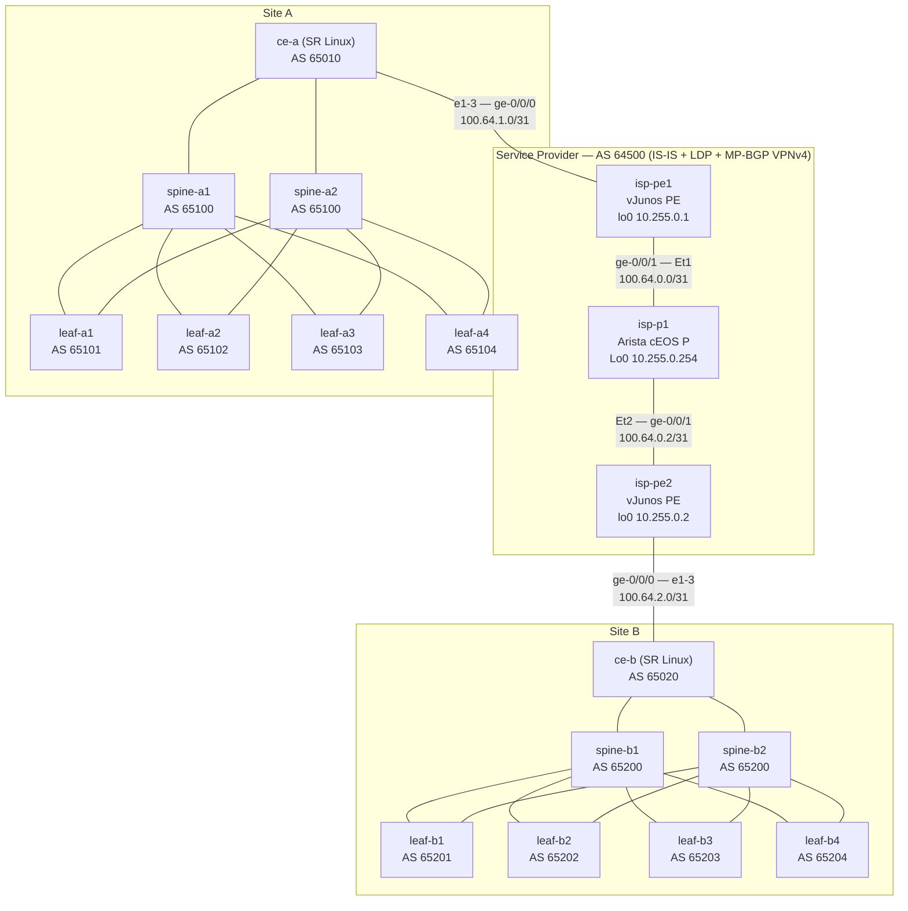

# my-first-lab — Two Leaf-Spine Sites over a Multi-Vendor MPLS L3VPN

This lab connects two data-center sites built on **Nokia SR Linux** leaf-spine fabrics through a
service-provider core made of **Juniper vJunos** PE routers and an **Arista cEOS** P router.
The provider transports customer traffic in an **MPLS BGP L3VPN** (RFC 4364): the two sites
share one routing domain while the provider core never sees customer routes.

The lab is managed as Infrastructure-as-Code with EVE-IaC:

| File | Purpose |
|---|---|
| `topology.yml` | Nodes, links, traffic filters (desired state) |
| `configs/` | Startup configuration of every node (SR Linux JSON, Junos, EOS, VPCS) |
| `.eve-iac.yml` | Project manifest (managed lab `/IaC/my-first-lab.unl`) |

---

## 1. Topology



Each leaf has two VPCS clients attached (16 PCs in total), not drawn above.

### 1.1 Node inventory

| Role | Nodes | Vendor / template | Resources |
|---|---|---|---|
| Spine | spine-a1, spine-a2, spine-b1, spine-b2 | Nokia SR Linux 26.7 (`srlinux-ixr-d2l`) | 4 vCPU / 4 GB |
| Leaf | leaf-a1..a4, leaf-b1..b4 | Nokia SR Linux 26.7 (`srlinux-ixr-d2l`) | 4 vCPU / 4 GB |
| Site border (CE) | ce-a, ce-b | Nokia SR Linux 26.7 (`srlinux-ixr-d2l`) | 4 vCPU / 4 GB |
| Provider Edge (PE) | isp-pe1, isp-pe2 | Juniper vJunos Router 26.2R1.7 | **4 vCPU / 8 GB** |
| Provider (P) | isp-p1 | Arista cEOS-lab 4.35.1F | 4 GB |
| Clients | pc-a1-1 … pc-b4-2 | VPCS | — |

> **Why are the SR Linux border routers CEs and not PEs?** The SR Linux 7220 IXR-D2L/D3/D3L
> images available on this EVE server do not implement LDP, BGP-IPVPN or `system mpls`.
> MPLS is therefore terminated on the Juniper PEs, which is the classic provider model anyway:
> the customer edge only speaks plain eBGP to its provider.

### 1.2 Cabling

| A side | Interface | B side | Interface |
|---|---|---|---|
| spine-x1 / spine-x2 | ethernet-1/1 … 1/4 | leaf-x1 … leaf-x4 | ethernet-1/1 (spine 1) / ethernet-1/2 (spine 2) |
| spine-x1 / spine-x2 | ethernet-1/5 | ce-x | ethernet-1/1 (spine 1) / ethernet-1/2 (spine 2) |
| leaf-xN | ethernet-1/3 | pc-xN-1 | eth0 |
| leaf-xN | ethernet-1/4 | pc-xN-2 | eth0 |
| ce-a | ethernet-1/3 | isp-pe1 | ge-0/0/0 |
| isp-pe1 | ge-0/0/1 | isp-p1 | Ethernet1 |
| isp-p1 | Ethernet2 | isp-pe2 | ge-0/0/1 |
| isp-pe2 | ge-0/0/0 | ce-b | ethernet-1/3 |

---

## 2. Addressing plan

### 2.1 Loopbacks and AS numbers

| Node | Loopback | AS |
|---|---|---|
| spine-a1 / spine-a2 | 10.1.0.1 / 10.1.0.2 (system0) | 65100 |
| leaf-a1 … leaf-a4 | 10.1.0.11 … 10.1.0.14 | 65101 … 65104 |
| ce-a | 10.1.0.254 | 65010 |
| spine-b1 / spine-b2 | 10.2.0.1 / 10.2.0.2 | 65200 |
| leaf-b1 … leaf-b4 | 10.2.0.11 … 10.2.0.14 | 65201 … 65204 |
| ce-b | 10.2.0.254 | 65020 |
| isp-pe1 | 10.255.0.1 (lo0) | 64500 |
| isp-pe2 | 10.255.0.2 (lo0) | 64500 |
| isp-p1 | 10.255.0.254 (Loopback0) | 64500 (IGP only) |

### 2.2 Point-to-point links (/31)

Pattern for site *S* (S=1 for A, S=2 for B), spine *s* (1-2), leaf *l* (1-4):

| Link | Subnet | Spine/upper side | Lower side |
|---|---|---|---|
| spine-s ↔ leaf-l | `10.S.s.(2l-2)/31` | `.(2l-2)` | `.(2l-1)` |
| spine-s ↔ ce | `10.S.s.100/31` | `.100` | `.101` |

Examples: spine-a1 ↔ leaf-a3 = `10.1.1.4/31` (spine .4, leaf .5); spine-b2 ↔ ce-b = `10.2.2.100/31`.

| Provider link | Subnet | Addresses |
|---|---|---|
| ce-a ↔ isp-pe1 | 100.64.1.0/31 | PE .0, CE .1 |
| isp-pe1 ↔ isp-p1 | 100.64.0.0/31 | PE .0, P .1 |
| isp-p1 ↔ isp-pe2 | 100.64.0.2/31 | P .2, PE .3 |
| isp-pe2 ↔ ce-b | 100.64.2.0/31 | PE .0, CE .1 |

### 2.3 Client subnets

Each VPC sits alone in a routed /24 whose gateway is the leaf (`.1`); the PC is `.10`.

| Site | Subnet pattern | Example |
|---|---|---|
| A | `10.10.<leaf><pc>.0/24` | pc-a3-2 = 10.10.32.10, gw 10.10.32.1 |
| B | `10.20.<leaf><pc>.0/24` | pc-b4-1 = 10.20.41.10, gw 10.20.41.1 |

---

## 3. Routing design — how traffic flows

The lab is built in three layers. Each layer only needs to understand its direct neighbours,
which is why three vendors interoperate cleanly: every protocol used is an IETF standard.

| Layer | Protocol | Where | Purpose |
|---|---|---|---|
| Site fabric | eBGP (RFC 4271, RFC 7938 style) | SR Linux ↔ SR Linux | Underlay/overlay routing inside each DC |
| Customer access | eBGP (PE-CE) inside VRF `CUST` | SR Linux CE ↔ Junos PE | Exchange site prefixes with the provider |
| Provider IGP | IS-IS Level-2, wide metrics | Junos ↔ EOS | Reachability of PE/P loopbacks |
| Provider transport | MPLS + LDP (RFC 5036) | Junos ↔ EOS | Label-switched paths between PE loopbacks |
| Provider service | MP-iBGP VPN-IPv4 (RFC 4364) | Junos ↔ Junos | Carry customer routes + VPN labels |

### 3.1 Site fabric — eBGP leaf-spine (SR Linux)

* Every leaf has its **own private AS**; both spines of a site share one AS (65100 / 65200).
  This is the RFC 7938 "BGP in the data center" model: no IGP, no iBGP, loop prevention by AS-path.
* Sessions are built on the /31 interface addresses (no loopback peering, no BFD).
* Export policy `export-all` advertises connected subnets (PC /24s, /31s, system0) — SR Linux
  requires an explicit policy because eBGP default policy is otherwise reject.
* Leaf-to-leaf traffic inside a site: `leaf → spine → leaf` (TTL drop of 3 → VPCs see TTL 61).
* The **CE** (ce-a / ce-b) peers with both spines and with the provider PE; it simply re-advertises
  site routes to the provider and provider-learned routes (the other site) into the fabric.

### 3.2 Provider core — IS-IS + LDP (Junos / EOS)

* **IS-IS Level-2** runs on the PE–P links (point-to-point) and advertises the loopbacks
  `10.255.0.1`, `10.255.0.2`, `10.255.0.254`. Loopbacks are passive.
* **LDP** distributes a label for each loopback FEC. On the Juniper PE the result is the
  `inet.3` table — the table BGP uses to resolve VPN next-hops.
* The P router uses **penultimate-hop popping (PHP)**: it removes the transport label before
  handing the packet to the egress PE (visible as `pop` in `show mpls lfib route`).

### 3.3 MPLS L3VPN service (Junos)

* VRF **`CUST`** on each PE contains the CE-facing interface `ge-0/0/0.0`.
* **Route Distinguisher**: `10.255.0.1:100` (pe1), `10.255.0.2:100` (pe2) — makes customer
  prefixes unique in `bgp.l3vpn.0`.
* **Route Target**: `target:64500:100` exported and imported on both PEs (`vrf-target`).
* **`vrf-table-label`**: one VPN label per VRF; the egress PE pops it and performs an IP lookup
  in `CUST.inet.0`.
* PEs are iBGP neighbours on their loopbacks with `family inet-vpn unicast`.

**Isolation**: customer prefixes exist only in `CUST.inet.0` / `bgp.l3vpn.0` on the PEs.
The P router and the PEs' global tables have no route to 10.10.x / 10.20.x — the core is
"BGP-free" and the customer is isolated from the provider and from any other VPN.

### 3.4 Packet walk: pc-a1-1 → pc-b4-1 (10.10.11.10 → 10.20.41.10)

```
pc-a1-1 ── leaf-a1 ── spine-a1/2 ── ce-a ─────────── isp-pe1 ═══════ isp-p1 ═══════ isp-pe2 ─────────── ce-b ── spine-b1/2 ── leaf-b4 ── pc-b4-1
   IPv4      IPv4        IPv4        IPv4  (eBGP)     push 2 labels   pop (PHP)     pop VPN label    IPv4 (eBGP)    IPv4         IPv4
                                                     [LDP 100001]                   lookup CUST
                                                     [VPN 16][IP]   [VPN 16][IP]
```

1. Fabric A routes the packet to **ce-a**, which learned the specific prefix `10.20.41.0/24`
   from isp-pe1 with AS-path `64500 65020 65200 65204` (the spines/leaves see `65010` prepended).
2. **isp-pe1** looks up `CUST.inet.0`: next-hop is pe2 (10.255.0.2) with VPN label **16**;
   it resolves 10.255.0.2 in `inet.3` → LDP label **100001** toward isp-p1. Two labels are pushed:
   ```
   10.20.41.0/24 *[BGP/170] from 10.255.0.2
                  AS path: 65020 65200 65204 I
                > to 100.64.0.1 via ge-0/0/1.0, Push 16, Push 100001(top)
   ```
3. **isp-p1** (EOS) sees top label 100001 = FEC 10.255.0.2, it is the penultimate hop → **pop**.
   The frame leaves with only the VPN label 16.
4. **isp-pe2** receives label 16 = VRF `CUST` table label → pops it and routes the IP packet to ce-b.
5. Fabric B delivers it to pc-b4-1. End-to-end the VPC sees **TTL 55** (9 IP hops; the P router
   decrements the MPLS TTL with `ttlMode uniform`).

> `validation-state: unverified` in Junos output refers to RPKI route-origin validation, which is
> not configured in this lab. It is informational only.

---

## 4. Verification commands

### 4.1 Nokia SR Linux (spines, leaves, CEs)

Console tip: SR Linux opens `sr_cli`; if the prompt does not appear, **press Enter once**.

| What | Command |
|---|---|
| Version / platform | `show version` |
| Interfaces and IPs | `show interface brief` · `show interface ethernet-1/1` |
| BGP sessions | `show network-instance default protocols bgp neighbor` |
| Received routes from a peer | `show network-instance default protocols bgp neighbor 10.1.1.1 received-routes ipv4` |
| Routing table | `show network-instance default route-table ipv4-unicast summary` |
| One prefix | `show network-instance default route-table ipv4-unicast prefix 10.20.41.0/24` |
| BGP configuration | `info flat network-instance default protocols bgp` |
| Ping from the router | `ping 10.20.41.10 network-instance default` |
| Traceroute | `traceroute 10.20.41.10 network-instance default` |

Expected: on a spine, 5 neighbours *established* (4 leaves + CE); on a CE, 3 (2 spines + PE).

### 4.2 Juniper vJunos (isp-pe1, isp-pe2)

Login `root` / `Lab-Root123`, then `cli`.

| What | Command |
|---|---|
| Interfaces | `show interfaces terse ge-0/0/*` |
| IS-IS adjacency | `show isis adjacency` |
| IS-IS database | `show isis database` |
| LDP neighbours / sessions | `show ldp neighbor` · `show ldp session` |
| LDP label bindings | `show ldp database` |
| Transport LSPs (BGP next-hop resolution) | `show route table inet.3` |
| MPLS label table | `show route table mpls.0` |
| BGP sessions (iBGP VPN + eBGP CE) | `show bgp summary` |
| VPN routes (with RD) | `show route table bgp.l3vpn.0` |
| VRF routing table | `show route table CUST.inet.0` |
| Label stack for a customer prefix | `show route 10.20.41.0/24 table CUST.inet.0 detail` |
| Routes advertised to the remote PE | `show route advertising-protocol bgp 10.255.0.2` |
| Routes received from the CE | `show route receive-protocol bgp 100.64.1.1 table CUST.inet.0` |
| VRF forwarding table | `show route forwarding-table vpn CUST` |
| Ping inside the VRF | `ping 10.20.41.10 routing-instance CUST` |
| MPLS LSP ping | `ping mpls ldp 10.255.0.2/32` |

Expected on isp-pe1: IS-IS `Up` to isp-p1, LDP neighbour 100.64.0.1, BGP `Establ` to
10.255.0.2 (bgp.l3vpn.0 routes) and to 100.64.1.1 (CUST.inet.0 routes).

### 4.3 Arista cEOS (isp-p1)

Enter privileged mode with `enable`.

| What | Command |
|---|---|
| Interfaces | `show ip interface brief` |
| IS-IS neighbours | `show isis neighbors` |
| IS-IS routes | `show ip route isis` |
| LDP neighbours | `show mpls ldp neighbor` |
| LDP bindings | `show mpls ldp bindings` |
| MPLS forwarding (label swap/pop) | `show mpls lfib route` |
| Prove the core is BGP-free | `show ip route 10.20.41.0/24` → *no route* |
| Running config | `show running-config section isis` · `show running-config section mpls` |

Expected LFIB: one LDP label per PE loopback with action **pop** (PHP).

### 4.4 VPCS clients

| What | Command |
|---|---|
| IP configuration | `show ip` |
| Ping (intra-site) | `ping 10.10.42.10 -c 3` → TTL 61 |
| Ping (inter-site, through MPLS) | `ping 10.20.41.10 -c 3` → TTL 55 |
| Traceroute | `trace 10.20.41.10` |

---

## 5. Traffic visualisation filters

Two EVE live traffic filters are defined in `topology.yml` (classic libpcap/BPF syntax):

| Key | Title | Expression | Lights up |
|---|---|---|---|
| `filter_1` | ICMP | `icmp` | Fabric links, CE–PE links (plain IPv4, EtherType 0x0800) |
| `filter_2` | ICMP in MPLS | `mpls && (icmp \|\| (mpls && icmp))` | PE–P links (EtherType 0x8847) |

Why the nested expression? Each `mpls` keyword shifts libpcap offsets by one 4-byte label for the
rest of the expression:

* **PE → P** frames carry **2 labels** (LDP transport + VPN) → matched by `mpls && mpls && icmp`.
* **P → PE** frames carry **1 label** (transport popped by PHP) → matched by `mpls && icmp`.

Start a ping from a site-A PC to a site-B PC and watch green (IPv4) and orange (MPLS) links.

---

## 6. Operating the lab with EVE-IaC

| Task | Tool |
|---|---|
| Show desired topology | `eve_iac_public` |
| Validate topology + configs | `eve_iac_validate` |
| Preview changes vs. EVE | `eve_iac_plan` |
| Apply changes | `eve_iac_reconcile` |
| Start / stop nodes | `eve_iac_start` / `eve_iac_stop` |
| Run device commands | `eve_iac_console_exec` / `eve_iac_console_exec_many` |

Notes:

* A node reads its startup configuration only on a **clean boot**: after editing a config,
  the node must be stopped → wiped → started (reconcile handles it).
* SR Linux startup files are JSON with `srl_nokia-*` module prefixes; an invalid file makes the
  node boot in `[FACTORY]` mode.
* vJunos needs at least **4 vCPU / 8 GB**: with less memory the inner Junos VM (VCP) does not get
  enough RAM and never starts (`VCPMEM in MB: -2080` on the console).
* vJunos boots in two stages (Linux host, then Junos): the first `login:` prompt belongs to the
  host; wait for `FreeBSD/amd64 (isp-pe1) (ttyu0)`.
